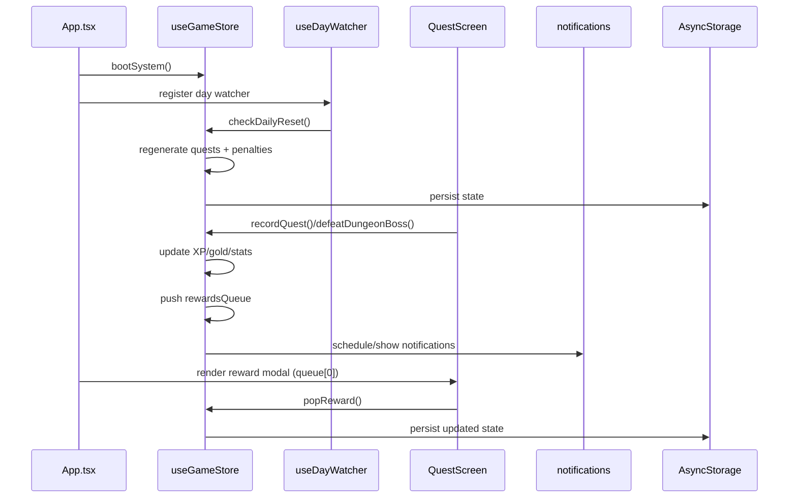
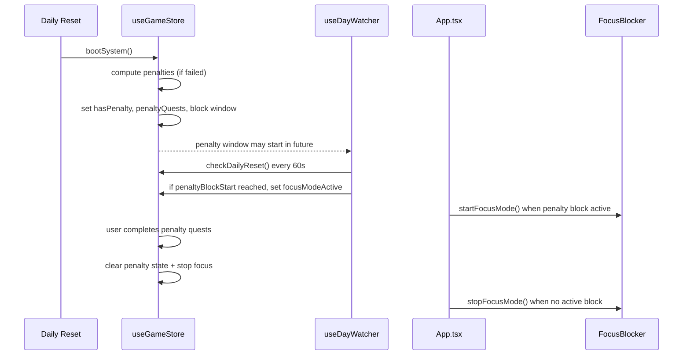
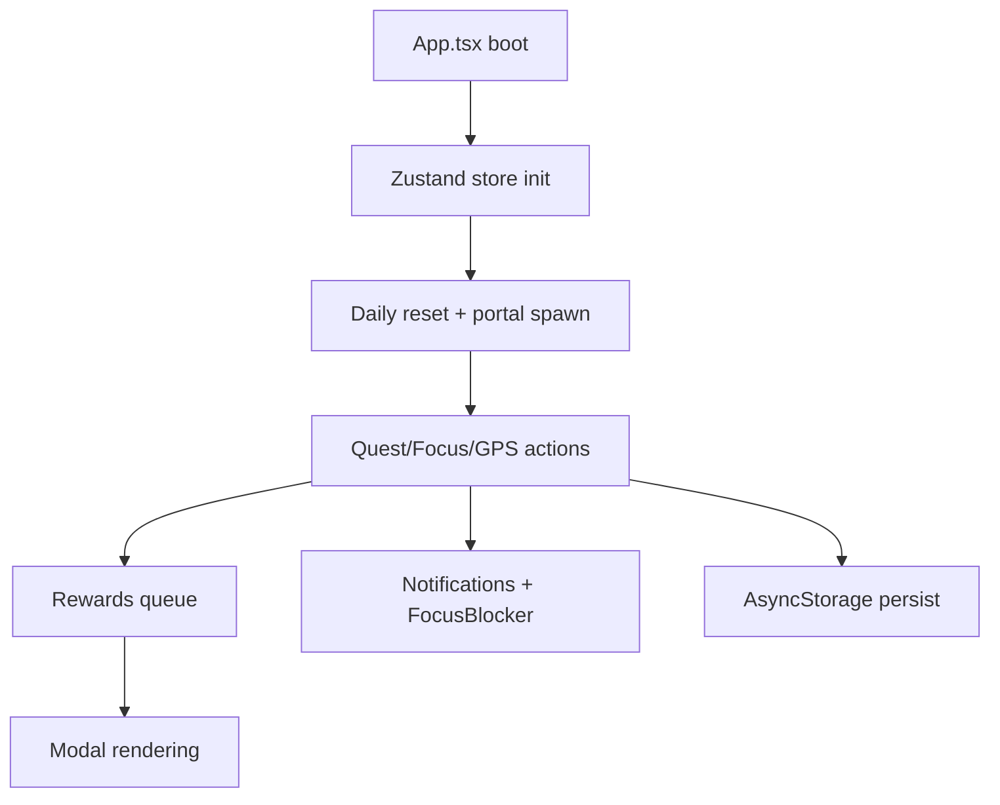

# Solo Leveling RN — Architecture

## Purpose
Solo Leveling RN is a gamified productivity app inspired by RPG systems. Users complete daily missions (training, focus, GPS), earn XP/gold, unlock ranks/shadows, and handle penalties if they miss goals. The app runs fully on-device with local persistence and optional OS-level focus blocking on Android.

## Design Goals (implicit from code)
- Offline-first: all gameplay works without backend.
- Deterministic daily structure: quest generation is seeded per day.
- RPG progression loop: XP, gold, ranks, shadows, and achievements provide feedback.
- Accountability: penalties and optional app blocking reinforce missed goals.
- Low friction: rewards are queued and surfaced as modals without navigation jumps.

## High-Level Architecture
- **App shell + navigation**: Tab-based navigation using React Navigation, with global HUD and reward/penalty overlays. See [App.tsx](App.tsx#L1).
- **State + logic**: A single Zustand store holds game state, rules, and progression logic. See [src/store/useGameStore.ts](src/store/useGameStore.ts#L1).
- **UI layers**:
  - **Screens**: top-level tabs (Status, Missions, Shop, Inventory, Focus, Shadows). See [src/screens](src/screens).
  - **Components**: reusable modals, cards, and overlays used across screens. See [src/components](src/components).
- **Data catalogs**: static content for quests, bosses, keys, themes, items, achievements, etc. See [src/data](src/data).
- **Device integration**: notifications, audio/vibration, GPS tracking, and Android app-blocking (native module). See [src/utils](src/utils) and [src/hooks](src/hooks).

## Runtime Flow (happy path)
1. **Boot**: App mounts, initializes store, audio, and notifications. See [App.tsx](App.tsx#L46).
2. **Daily system check**: A watcher detects day change and triggers resets and portal spawns. See [src/hooks/useDayWatcher.ts](src/hooks/useDayWatcher.ts#L1). `checkDailyReset()` is an alias for `bootSystem()` — both perform the same daily reset logic guarded by `lastResetDate`.
3. **User completes missions**:
   - Missions/quests update store (XP, gold, stats, streaks).
   - Rewards are queued and shown via sequential modals.
4. **Focus or GPS missions**:
   - Focus mode may start an OS-level app block (Android) and schedule notifications.
   - GPS missions track distance with anti-cheat logic.
5. **Persist**: Store is persisted to AsyncStorage via Zustand middleware for offline-first behavior.

## Navigation & UI Layer
- **Navigation**: `MaterialTopTabNavigator` in bottom position (tab bar). See [App.tsx](App.tsx#L87).
- **Global overlays**:
  - System HUD (rank/settings) sits above navigation.
  - Reward queue renders a single modal at a time to avoid overlap.
  - Penalty modal is prioritized when penalty is triggered.
  - Level-up toast (non-5/10 levels) is suppressed while modals/reward overlays are active to avoid late/short display.
- **Theme system**: Theme colors are derived from a theme catalog and the active theme in the store. See [src/theme.ts](src/theme.ts#L1).

## State Management (Zustand)
- **Store**: `useGameStore` holds all core state and actions.
- **Primary state slices**:
  - `player`: XP, level, attributes, inventory, shadows, themes.
  - `quests`: daily quests + extras + side quests.
  - `system`: penalties, boss rotations, cooldowns, focus blocks, tutorial phase.
  - `statistics`: aggregated counters for achievements and UI.
- **Persistence**:
  - Persisted with `zustand/middleware` and `AsyncStorage`.
  - Daily reset logic reconciles stored data with current date.

## Domain Model (AI-friendly)

### Player
Defined in [src/store/types.ts](src/store/types.ts#L1).
- Identity/progression: `name`, `level`, `xp`, `rank`, `maxLevelReached`.
- Economy: `gold`.
- Attributes: `strXp`, `agiXp`, `intXp`, `vitXp` and derived `str`, `agi`, `int`, `vit`.
- Streaks: `currentStreak`, `highestStreak`.
- Inventory: list of `InventoryEntry { itemId, quantity }`.
- Dungeon keys: `dungeonKeys` (string ids).
- Shadows: owned `shadows` (levelled entries), active `activeShadowIds`.
- Themes: `unlockedThemes`, `activeThemeId`.

### Quest
Defined in [src/store/types.ts](src/store/types.ts#L1).
- Identity: `id`, `label`, `detail`.
- Rewards: `xp`, `gold`, optional `rewards`.
- Type: `training | knowledge | focus | gps | forbidden | limit | pomodoro`.
- State: `done`, optional `failed`.
- Metrics: `targetValue`, `currentValue`, `focusDuration`, `gpsTarget`, `pomodoroTarget`.
- Rank: `rank` indicates difficulty tier derived from XP.

### System State
Defined in [src/store/types.ts](src/store/types.ts#L1).
- Penalty: `hasPenalty`, `penaltyReduced`, `penaltyTriggered`, `penaltyQuests`.
- Focus blocking: `focusModeActive`, `hardcoreFocusMode`, `hardcorePunished`, `blockedApps`.
- Time windows: `focusStartTime`, `focusEndTime`, `penaltyBlockStart`, `penaltyBlockEnd`.
- Boss tracking: weekly/normal rotation ids, `bossesDefeated`, event boss state.
- Rewards and tutorial: `tutorialPhase`, `rewardsQueue` (store-level queue).
- Pomodoro: `pomodoroPhase`, `pomodoroCycle`, `pomodoroBreakEnd`.

### Shop Item
Defined in [src/data/shopItems.ts](src/data/shopItems.ts#L1).
- Identity: `id`, `name`, `description`, `lore`.
- Economy: `cost`, optional `weeklyStock`.
- Effect: `effect` enum controls behavior; optional `effectValue`/`effectGold`.
- Buffs: optional `buffStat`, `buffMult`, `buffDuration`.

### Shadow
Defined via registry in [src/data/shadows.ts](src/data/shadows.ts#L1).
- Rank tiers: Normal, Elite, Knight, Commander, Marshal.
- Unlock methods: gacha, boss drop, shop, achievement, custom.
- Passives: `passiveEffect` influences XP, gold, penalties, loot, etc.
- Active set: at most 3 in Vanguard; passives scale by level.

### Achievement
Defined in [src/data/achievements.ts](src/data/achievements.ts#L1).
- Event-driven: `conditionType` corresponds to store-triggered events.
- Tiered progression: optional tiers (Bronze → Legendary) with targets.
- Rewards: gold and optional XP, either per tier or instant.

## Progression & Economy

### XP, Leveling, and Ranks
- XP requirement is linear: `xpForLevel(level) = 100 * level`. See [src/store/helpers.ts](src/store/helpers.ts#L1).
- Level ups are applied by repeatedly subtracting required XP until XP < threshold.
- Rank progression uses `CLASS_REQUIREMENTS` with level + mission + boss conditions. See [src/store/helpers.ts](src/store/helpers.ts#L1).
- Rank progress displayed in HUD uses a weighted mix of level, completed missions, and rank-specific requirements.

### Attributes
- Attribute XP gain is per quest type (training, focus, gps, etc.). See [src/store/helpers.ts](src/store/helpers.ts#L1).
- Attribute levels are derived via `attrLevelFromXP` (sqrt-based growth).

### Gold
- Gold is earned from quests, items, and boss rewards.
- Gold is spent in the shop, shadow recruitment, and some systems (indirectly).

### Active Buffs
- Buffs are applied via items and boss drops and stored in `activeBuffs`.
- Buffs affect XP/gold multipliers, loot rates, focus duration, and penalties.
- Some shadow passives (weekly cooldown) can nullify penalty or protect streaks:
  - `penalty_immunity`: if active and cooldown available, the entire penalty is absorbed — XP/gold loss, block window, and penalty quests are all cancelled. The `penaltyImmunityUsed` flag ensures the main daily-reset `set()` does not re-apply `hasPenalty: true` after the immunity fires.
  - `streak_protect`: if streak would reset on a failed day, the streak is preserved (once per week).

## Quest Generation & Daily Cycle

### Daily Quest Generation
Implemented in [src/store/questDictionary.ts](src/store/questDictionary.ts#L1).
- Quest definitions are categorized as `core`, `pool`, and `boss`.
- Daily quest count depends on difficulty and player level via `getDailyMissionTarget` (or `customDailyMissions` when difficulty is `custom`).
- Selection from pool is deterministic per day using a seeded shuffle (seed derived from date).
- Targets scale per level using `scalingAmount` and `scalingInterval`.
- Dynamic scaling increases targets by 5% every 5 levels for elite/boss content.

### Quest Types
- `training`: physical reps/time.
- `knowledge`: learning tasks.
- `focus`: time-based focus sessions.
- `gps`: distance-based tracking.
- `forbidden`: avoid an action.
- `limit`: cap a behavior (count-down).
- `pomodoro`: cycle-based productivity.

### Penalty Quests
Defined in [src/store/questDictionary.ts](src/store/questDictionary.ts#L1).
- Triggered if daily missions or side quests fail (unless rest day).
- Penalty quests are a fixed pool; the store selects a subset.
- Penalty window may enforce blocking via native module if enabled.

### Penalty Block Windows (autoBlockApps)
Implemented in [src/store/useGameStore.ts](src/store/useGameStore.ts#L260).
- **`missionDifficulty`** (not `punishmentIntensity`) controls block duration windows:
  - easy: 6h (13:00–19:00)
  - normal: 12h (10:00–22:00)
  - hard: 24h (immediate start + 24h)
- If time window already passed when penalty is applied, it shifts both start and end to the next day.
- When penalty window opens, `focusModeActive` is set so native blocker can activate.
- The block end time (`penaltyBlockEnd`) is **not** reduced by focus sessions; it expires at its real-time wall-clock value. The penalty is only lifted when all penalty quests are completed (`completeQuest`) or when the real-time window expires.

## Missions, Bosses, and Keys

### Bosses and Raids
- Raid boss catalog includes rank, HP, duration, and visual metadata. See [src/data/bosses.ts](src/data/bosses.ts#L1).
- Boss completion triggers reward logic and achievement events.

### Raid Boss HP Formula
Implemented in [src/store/useGameStore.ts](src/store/useGameStore.ts#L260).
- HP scales with expected daily XP and boss rank:
  - estimate daily XP from core + pool quests
  - multiply by duration days and rank difficulty factor
- When HP reaches 0, rewards are granted and a raid extraction is queued.

### Dungeon Keys
- Key metadata is defined in [src/data/dungeonKeys.ts](src/data/dungeonKeys.ts#L1).
- Keys are unlocked by level or loot boxes.
- Key missions map to training/focus/gps tasks with custom narrative text.
- Key usage is gated by a 24h cooldown per key id. See [src/store/useGameStore.ts](src/store/useGameStore.ts#L780).

### Dynamic Portals (Dungeon Breaks)
Implemented in [src/store/useGameStore.ts](src/store/useGameStore.ts#L1400).
- Spawn check runs hourly (with a per-hour roll guard).
- 30% chance per hour, capped to 3 spawns per day.
- Portal duration is random between 30 min and 3h.
- Cooldown of 45 min after portal expires.
- Portal sources can be boss definitions or raid break bosses.

## Focus Mode and Blocking

### Focus Sessions
- Focus sessions can be standard or hardcore (restricted exit).
- On start, optional app blocking uses `FocusBlocker` native module.
- `setFocusModeActive(true, endTimeMs)` writes both `focusEndTime` and `focusStartTime = Date.now()` to the store. `focusStartTime` is essential: the "manual stop" path in FocusScreen computes elapsed minutes from `(now - focusStartTime)` to call `recordFocusTime`. Without it, elapsed = 0 and no focus time is credited.
- On end (timer fires or manual stop), `recordFocusTime(minutes)` is called, which advances focus quests and records statistics.
- On end, rewards are applied and notifications may be sent.

### Hardcore Focus
- If hardcore is active, exit is blocked unless a special item is used.
- Hardcore can be forced as punishment based on penalty severity.

### Pomodoro
- Pomodoro quests define cycle counts; focus screen drives timer flow.
- Notifications are scheduled for break start/end. See [src/utils/notifications.ts](src/utils/notifications.ts#L1).

## GPS Tracking
Implemented in [src/hooks/useLocationTracker.ts](src/hooks/useLocationTracker.ts#L1) and [src/utils/gps.ts](src/utils/gps.ts#L1).
- Uses Haversine distance.
- Anti-cheat rejects points above 20 km/h.
- Tracks distance incrementally and completes mission at target km.

## Shop and Inventory

### Shop
Defined in [src/data/shopItems.ts](src/data/shopItems.ts#L1) and UI in [src/screens/ShopScreen.tsx](src/screens/ShopScreen.tsx#L1).
- Items support effects like skipping quests, XP boosts, penalty removal, loot boxes, and cosmetics.
- Weekly stock is enforced for some items.
- Shadow recruitment is gated by level and uses a dedicated modal.

### Loot Box Odds
Implemented in [src/store/useGameStore.ts](src/store/useGameStore.ts#L780).
- Base odds: 70% gold / 20% XP / 10% key (fallback to gold if no keys remain).
- `lootBoost` passive: reduces the gold threshold from 0.70 by dividing it by `(1 + lootBoost)`, shifting weight toward XP and keys. Gold and XP payout amounts are also multiplied by `(1 + lootBoost)`.
- The `LootBoxModal` is mutually exclusive with `rewardsQueue` modals: it will not render while the rewards queue has items. It shows after the queue drains.

### Inventory
Implemented in [src/screens/InventoryScreen.tsx](src/screens/InventoryScreen.tsx#L1).
- Items are consumed and apply effects via store actions.
- System Pass opens a quest picker to auto-complete a quest.
- Loot box opens reward logic and pushes to reward queue.

### Item Effects (important examples)
- `system_pass`: opens quest picker and auto-completes chosen quest.
- `relogio_ampulheta`: doubles XP of the next quest.
- `lagrima_purificacao`: removes active penalty immediately.
- `shadow_essence`: resets daily shadow extraction limit.
- Boss materials: apply timed XP/Gold buffs.

## Shadows System

### Shadow Catalog
Defined in [src/data/shadows.ts](src/data/shadows.ts#L1).
- Aggregates multiple sources (gacha, boss drops, achievements, shop, custom).
- Provides mapping by id and by rank for retrieval.

### Drop System — Rarity Philosophy

Shadow rarity (rank) reflects **boss difficulty + access rarity**:

| Category | Drop Mode | Drop Chance | Notes |
|---|---|---|---|
| **Raid Boss** | Guaranteed | 100% | Effort-based |
| **Event Boss** | Guaranteed | 100% | Once/year — always rewarding |
| **Discovered Dungeon** | Probabilistic | Elite: 45% / Knight: 38% / Commander: 28% | Free access, RNG tension |
| **Dungeon Break** | Probabilistic | Normal: 40% → Marshal: 12% | Random spawn, tiered by rank |
| **Key Boss (Lv-gated easy)** | Probabilistic | Knight: 28% / Commander: 20% | Key cost + mission |
| **Key Boss (Lv-gated hard)** | Probabilistic | Commander: 20% / Marshal: 15% | High investment |
| **Key Boss (Box-exclusive)** | Probabilistic | Variable 20–35% | Box loot required |

The `dropChance?: number` field on `Shadow` controls this. `undefined` = 1.0 = 100%.

#### Shadow Miss (UI)
When `getBossDropShadow()` returns `null` (boss has a shadow but roll failed), a `shadow_miss` item is pushed to `rewardsQueue` with `data: { shadowName, dropChance }`. The UI renders an inline overlay card ("A Sombra Fugiu!") showing the shadow name and drop chance percentage. No random fallback shadow is awarded on a miss. The `shadow_miss` type is part of the `rewardsQueue` union type in `GameState`.

### Gacha and Drops
- `rollShadow(rank, alreadyOwned)` draws from rank-specific pools using weighted `dropRate`.
- `getBossDropShadow(bossId)` returns `Shadow | null | undefined`:
  - `Shadow` = drop succeeded
  - `null` = boss has shadow but probabilistic roll failed (shadow_miss)
  - `undefined` = boss has no shadow drop registered
- `getBossDropPreview(bossId)` returns the first registered shadow for a boss (used in UI previews).

### Extraction Rules
Implemented in [src/store/useGameStore.ts](src/store/useGameStore.ts#L780).
- After all daily quests are complete, a shadow extraction is attempted once per day.
- `rollShadow` is called with an empty `alreadyOwned` list, so the full gacha pool for the rank is eligible — including shadows the player already has. Only when the player owns every shadow in that rank tier does `rollShadow` return `null` (no extraction).
- Extraction is inserted at the front of the reward queue so it appears first.
- If the rolled shadow is already owned, its level increases instead of a new unlock.

### Event Boss Trial Scaling
`buildEventTrials(def, C)` in [src/data/bosses.ts](src/data/bosses.ts) scales trial template values via `def.trialScale`:

| Scale | Events | Minutes × | km × | reps × |
|---|---|---|---|---|
| 1.0 (Light) | Valentine, Easter | ×1.0 | ×1.0 | ×1.0 |
| 1.2 (Medium) | Spring, Carnival, Black Friday, Long Nights | ×1.2 | ×1.2 | ×1.2 |
| 1.4 (Hard) | New Year, Harvest, Summer Titan | ×1.4 | ×1.4 | ×1.4 |
| 1.6 (Extreme) | Halloween, Winter Lich, Equinox, Yule, Festival | ×1.6 | ×1.6 | ×1.6 |

### Vanguard Passives
Implemented in [src/screens/ShadowsScreen.tsx](src/screens/ShadowsScreen.tsx#L1).
- Up to 3 active shadows in Vanguard.
- Passive values scale with level via linear multiplier.
- Passives include XP, gold, penalty reduction, loot boost, etc.

### Release
- Shadows can be released for gold (except custom shadows).
- Release amount depends on rank and level. See [src/store/helpers.ts](src/store/helpers.ts#L1).

## Achievements
Defined in [src/data/achievements.ts](src/data/achievements.ts#L1).
- Tracked via events emitted from the store (quest completion, boss defeat, focus sessions, penalty events, economy events).
- Tiered achievements store progress and reward per tier.
- Unlocking can grant gold/XP and sometimes shadows.

### Achievement Triggers
Defined in [src/data/achievements.ts](src/data/achievements.ts#L1).
- Quest events: completion, all done, undo/redo, late-night, skip.
- Focus events: session start/end, total focus hours, hardcore attempts.
- Boss events: raid defeat, boss-type completions, dungeon break.
- Economy events: purchases, gold totals, shop visits.
- Penalty events: triggered, cleared, veteran.
- Shadow/level events: shadow collected, level up.
- Daily events: login streak and side quest activity.

## Audio and Notifications

### Audio
Implemented in [src/utils/audioService.ts](src/utils/audioService.ts#L1).
- Uses react-native-sound for ambient loops and SFX if available.
- Falls back to vibration patterns to ensure feedback on all devices.
- Sounds are preloaded at boot.

### Notifications
Implemented in [src/utils/notifications.ts](src/utils/notifications.ts#L1).
- Notifee channel setup once at boot.
- Immediate and scheduled notifications for focus, pomodoro, and system warnings.
- Uses fixed IDs for idempotent rescheduling.

## Backup and Restore
Implemented in [src/screens/SettingsScreen.tsx](src/screens/SettingsScreen.tsx#L1).
- Export: serializes key state slices, base64 encodes, and copies to clipboard.
- Import: validates payload structure and restores store state.

### Backup Schema (keys exported)
Implemented in [src/screens/SettingsScreen.tsx](src/screens/SettingsScreen.tsx#L1).
- `player`, `system`, `statistics`
- `unlockedAchievements`, `achievementProgress`
- `customShadows`
- `quests`, `extraQuests`, `sideQuests`, `questDictionary`
- `questRecords`, `questCompletions`
- `extraQuestRerolledIds`, `extraQuestUsedPoolIds`
- `lastResetDate`, `activeMissionTimers`

## Reward Queue System
The store maintains `rewardsQueue` and App.tsx renders one reward at a time.
- Ensures sequential UX and avoids modal overlap.
- Reward types in the queue: boss defeat, achievement, shadow extraction, level up, job change.
- `LootBoxModal` (triggered by `currentLootReward`) is a separate channel outside the queue. It is suppressed while `rewardsQueue.length > 0` or `penaltyTriggered` is true — it shows only after the queue drains. This prevents simultaneous Modals.

### Reward Queue Ordering Rules
Implemented in [src/store/useGameStore.ts](src/store/useGameStore.ts#L780).
- Boss defeat inserts a boss modal first, then (optionally) shadow extraction (`shadow`) or a miss notification (`shadow_miss`).
- Daily completion inserts shadow extraction at the front of the queue.
- Level-up modal appears only on levels divisible by 5; otherwise a toast is shown.
- `skipQuest` correctly enqueues the level-up toast for non-multiple-of-5 levels (same behaviour as `completeQuest`, `addXP`, and `completeExtraQuest`).

## Persistence Strategy
- State is persisted via `zustand/middleware` to AsyncStorage.
- Daily reset reconciles quest generation and penalty state on app resume.
- Some state is rehydrated and then corrected on boot (ghost items cleanup).

### Persistence Merge + Migration
Implemented in [src/store/useGameStore.ts](src/store/useGameStore.ts#L1400).
- Migrates legacy shadow entries from string ids to `{ id, level }`.
- Rebuilds attribute XP from derived attribute values if missing.
- Normalizes dungeon keys on load via `getNewLevelKeys`.
- Resets transient fields (e.g., penaltyTriggered) in `partialize`.

## Widgets / External Sync
- Widget sync occurs in a throttled store subscription. See [src/store/useGameStore.ts](src/store/useGameStore.ts#L1400).
- Snapshot includes streak, daily quests, active shadows, and current rank/level.

## Key Features & Where They Live
- **Missions & penalties**: Mission generation, completions, and penalty logic live in [src/store/useGameStore.ts](src/store/useGameStore.ts#L1) and quest definitions in [src/store/questDictionary](src/store/questDictionary.ts).
- **Bosses & portals**: Boss data and mission triggers in [src/data/bosses](src/data/bosses.ts) and quest screen logic in [src/screens/QuestScreen.tsx](src/screens/QuestScreen.tsx#L1).
- **Inventory & shop**: Items are defined in [src/data/shopItems.ts](src/data/shopItems.ts) with purchase logic in [src/store/useGameStore.ts](src/store/useGameStore.ts#L1).
- **Shadows (summons)**: Shadow data and rolls in [src/data/shadows.ts](src/data/shadows.ts), with extraction UX in [src/components/ExtractionModal.tsx](src/components/ExtractionModal.tsx).
- **Achievements**: Rules and tracking in [src/data/achievements.ts](src/data/achievements.ts) and store hooks in [src/store/useGameStore.ts](src/store/useGameStore.ts#L1).
- **Dungeon keys**: Key catalog and mission mapping in [src/data/dungeonKeys.ts](src/data/dungeonKeys.ts#L1).

## Screen Walkthroughs (what each tab does)
- **Status**: Player overview (rank, attributes, achievements, stats breakdown) and job progression. This is the primary “progress dashboard.” See [src/screens/StatusScreen.tsx](src/screens/StatusScreen.tsx#L1).
- **Missões**: Daily quests, extras, side quests, event/raid flows, and dungeon key mission activation. This screen drives most progression events. See [src/screens/QuestScreen.tsx](src/screens/QuestScreen.tsx#L1).
- **Loja**: Shop inventory and purchases; updates player gold and inventory; ties into item definitions. See [src/screens/ShopScreen.tsx](src/screens/ShopScreen.tsx).
- **Inventário**: Displays owned items and key-based mission entry. See [src/screens/InventoryScreen.tsx](src/screens/InventoryScreen.tsx).
- **Focus Mode**: Configures focus sessions, app blocking, pomodoro cycles, and ambient audio. See [src/screens/FocusScreen.tsx](src/screens/FocusScreen.tsx#L1).
- **Sombras**: Shadow roster, extraction/upgrade flows, and active squad management. See [src/screens/ShadowsScreen.tsx](src/screens/ShadowsScreen.tsx).
- **Settings (modal/HUD)**: Global settings accessed via System HUD (notifications, sound, theme, penalties). See [src/screens/SettingsScreen.tsx](src/screens/SettingsScreen.tsx).

## Sequence Diagram — Daily Reset to Reward

## Practical File Map
- [App.tsx](App.tsx) — app shell, navigation, overlays, reward queue
- [src/store/useGameStore.ts](src/store/useGameStore.ts) — game state, actions, persistence
- [src/store/helpers.ts](src/store/helpers.ts) — leveling, ranks, attributes, passive math
- [src/store/questDictionary.ts](src/store/questDictionary.ts) — quest generation + penalty pool
- [src/screens](src/screens) — top-level UX flows
- [src/components](src/components) — modals, cards, overlays, settings sections
- [src/data](src/data) — catalogs for items, bosses, shadows, keys, achievements
- [src/hooks](src/hooks) — day watcher, GPS tracker
- [src/utils](src/utils) — notifications, audio, GPS math
- [android](android) / [ios](ios) — native modules and platform assets

## Store Action Map (mental API for AIs)
Core actions live in [src/store/useGameStore.ts](src/store/useGameStore.ts).
- **bootSystem**: daily reset + penalties + weekly resets + quest regeneration.
- **completeQuest / failQuest / skipQuest / undoQuest**: main quest lifecycle and rewards.
- **recordFocusTime / recordPomodoroSession**: focus/pomodoro progression and quest completion.
- **addSideQuest / completeSideQuest / removeSideQuest**: side quest lifecycle.
- **purchaseItem / useInventoryItem / openLootBox**: economy + inventory effects.
- **purchaseShadow / toggleActiveShadow / releaseShadow**: shadow lifecycle.
- **defeatDungeonBoss / dealRaidBossDamage**: boss and raid rewards, drop logic.
- **setFocusModeActive / setHardcoreFocusMode**: focus state toggles.
- **setEventBossState / completeEventTrial / markEventBossDefeated**: event boss progress.
- **generateExtraQuests / replaceExtraQuest / completeExtraQuest**: extra quest system.
- **checkDailyReset / checkDynamicPortalSpawn**: time-based systems.
- **restoreBackup**: rehydrate from exported state payload.

## Event Catalog (achievement triggers)
These strings drive achievement progression. See [src/data/achievements.ts](src/data/achievements.ts#L1).
- Quest: `quest_completed`, `all_quests_completed`, `quest_late_night`, `quest_at_midnight_edge`, `quest_undo_then_redo`, `quest_skipped_via_pass`
- Focus: `focus_session_started`, `focus_session_completed`, `focus_started_after_1am`, `focus_total_hours`, `hardcore_cancel_attempt`
- Boss: `boss_defeated`, `boss_gps_completed`, `boss_focus_completed`, `boss_training_completed`, `dungeon_break_cleared`
- Streak: `streak_updated`, `streak_protected`
- Economy: `item_purchased`, `lagrima_used_during_penalty`, `reloj_used`, `gold_total_earned`, `gold_spent_total`, `shop_visited`
- Extra/Side: `extra_quest_completed`, `all_extra_quests_completed`, `side_quest_added`, `side_quest_completed`, `login_streak_achieved`
- Shadow/Level: `shadow_collected`, `level_up`
- Penalty: `penalty_triggered`, `penalty_cleared`, `penalty_veteran`
- Rebellion: `blocked_app_attempt`, `blocked_app_spam`
- Daily: `daily_login`

## Reward/Drop Table (Boss → Items + Buffs)
Source: [src/data/shopItems.ts](src/data/shopItems.ts#L260) and [src/store/useGameStore.ts](src/store/useGameStore.ts#L780).
Machine-readable JSON: [reward_drop_table.json](reward_drop_table.json).

### Generic Boss Drops (always rolled)
- `shadow_essence` (45%): resets daily shadow extraction limit.
- `blood_fallen` (18%): +25% Gold for 3h.

### Item Effects (boss materials)
- `kasaka_venom`: +15% XP for 2h.
- `iron_will_crystal`: +50% XP for 30m.
- `blood_fallen`: +25% Gold for 3h.
- `igris_fragment`: +20% XP for 1h.
- `cerberus_fang`: +20% Gold for 2h.
- `dragon_scale`: +30% XP for 4h.
- `lich_eye`: +100% XP for 1h.

### Level-gated Dungeon Key Bosses
- `kasaka_venom_fang` → `kasaka_venom` (40%)
- `baruka_ice_elf` → `iron_will_crystal` (30%)
- `kargalgan_shaman` → `blood_fallen` (35%)
- `vulcan_greed_demon` → `blood_fallen` (30%), `igris_fragment` (20%)
- `metus_soul_guide` → `shadow_essence` (40%)
- `beru_ant_king` → `igris_fragment` (35%)
- `kamish_calamity` → `dragon_scale` (35%)
- `statue_of_god` → `iron_will_crystal` (30%), `lich_eye` (20%)
- `ashborn_shadow_monarch` → `dragon_scale` (40%), `lich_eye` (30%)

### Box-Exclusive Lore Bosses
- `dracula_vampire_lord` → `blood_fallen` (45%)
- `cthulhu_mad_god` → `lich_eye` (40%), `shadow_essence` (35%)
- `sauron_dark_lord` → `iron_will_crystal` (35%)
- `sun_wukong_celestial` → `iron_will_crystal` (35%)
- `kratos_ghost_sparta` → `blood_fallen` (40%), `igris_fragment` (25%)

### Key-Gated Bosses (Batch 2)
- `key_boss_basilisk` → `kasaka_venom` (40%)
- `key_boss_manticore` → `cerberus_fang` (35%)
- `key_boss_phoenix_rebirth` → `iron_will_crystal` (40%)
- `key_boss_beholder_eye` → `lich_eye` (40%)
- `key_boss_demon_prince_astaroth` → `blood_fallen` (35%)
- `key_boss_undead_dragon_king` → `dragon_scale` (40%)
- `key_boss_titania_queen_dark` → `shadow_essence` (40%)
- `key_boss_anubis_guardian_soul` → `iron_will_crystal` (35%)
- `key_boss_cerberus_gate_final` → `cerberus_fang` (55%)
- `key_boss_medusa_queen_gaze` → `kasaka_venom` (45%)
- `key_boss_hydra_ancient_world` → `kasaka_venom` (35%), `blood_fallen` (30%)
- `key_boss_fenrir_wolf_star` → `iron_will_crystal` (35%)
- `key_boss_odin_simulation_valhalla` → `iron_will_crystal` (40%), `lich_eye` (25%)
- `key_boss_zeus_simulation_olympus` → `iron_will_crystal` (40%)
- `key_boss_cthulhu_spawn_outer` → `lich_eye` (40%), `shadow_essence` (35%)

### Raid Bosses — Rank B
- `steel_fanged_lycan` → `blood_fallen` (25%)
- `hobgoblin_chieftain` → `blood_fallen` (25%)
- `twin_headed_ogre` → `blood_fallen` (30%)
- `undead_legionnaire` → `shadow_essence` (25%)
- `mountain_troll_brute` → `blood_fallen` (25%)
- `inferno_hound_alpha` → `blood_fallen` (25%)
- `cave_horror_spider` → `blood_fallen` (20%)

### Raid Bosses — Rank A
- `giant_ice_bear` → `iron_will_crystal` (25%)
- `high_orc_guard` → `blood_fallen` (25%)
- `naga_general` → `kasaka_venom` (30%)
- `high_orc_raider` → `blood_fallen` (25%)
- `dark_elf_assassin_leader` → `shadow_essence` (25%)
- `harpy_matriarch` → `shadow_essence` (25%)
- `chimera_of_waste` → `kasaka_venom` (30%)

### Raid Bosses — Rank S
- `demon_king_baran` → `iron_will_crystal` (35%), `lich_eye` (20%)
- `monarch_querehsha` → `shadow_essence` (35%), `blood_fallen` (25%)
- `monarch_silad` → `iron_will_crystal` (30%)
- `architect_system` → `iron_will_crystal` (35%), `lich_eye` (25%)
- `rathalos_sky` → `dragon_scale` (30%)
- `kurama_spirit` → `blood_fallen` (30%)
- `vampire_noble_valerius` → `blood_fallen` (35%)
- `archdemon_malphas` → `blood_fallen` (30%), `shadow_essence` (20%)
- `abyssal_kraken_tentacle` → `kasaka_venom` (30%)
- `ancient_guardian_statue` → `iron_will_crystal` (30%)
- `spectral_lich_king_shadow` → `lich_eye` (35%)

### Raid Bosses — National / Monarchs
- `monarch_rakan` → `dragon_scale` (30%)
- `monarch_legia` → `iron_will_crystal` (35%)
- `monarch_antares` → `dragon_scale` (40%)
- `malenia_blade` → `blood_fallen` (35%), `iron_will_crystal` (25%)
- `lich_king_arthas` → `lich_eye` (40%), `iron_will_crystal` (25%)
- `sephiroth_angel` → `shadow_essence` (35%), `iron_will_crystal` (25%)
- `acnologia_chaos` → `dragon_scale` (40%), `iron_will_crystal` (20%)
- `morgoth_abyss` → `dragon_scale` (40%), `lich_eye` (30%)
- `monarch_yogumun_giant` → `iron_will_crystal` (30%)
- `monarch_silad_true` → `iron_will_crystal` (35%)
- `national_hunter_thomas` → `iron_will_crystal` (40%)
- `dragon_monarch_general_1` → `dragon_scale` (35%)
- `abyssal_void_walker` → `shadow_essence` (35%)
- `seraphim_fallen_angel` → `iron_will_crystal` (35%)
- `monarch_of_beginnings` → `dragon_scale` (45%), `lich_eye` (40%), `iron_will_crystal` (35%)

### Discovered Dungeon Bosses
- `alpha_wolf` → `blood_fallen` (35%)
- `sea_king` → `kasaka_venom` (40%)
- `dungeon_queen` → `shadow_essence` (40%)
- `king_of_the_dead` → `lich_eye` (40%), `shadow_essence` (30%)
- `boss_crypt_omega` → `shadow_essence` (35%), `lich_eye` (25%)
- `boss_seraphim` → `iron_will_crystal` (40%), `lich_eye` (25%)

### Dungeon Break Bosses
- `break_boss_lich_servant_vanguard` → `shadow_essence` (25%)
- `break_boss_giant_worm_abyss` → `blood_fallen` (20%)
- `break_boss_dark_knight_traitor` → `blood_fallen` (25%)
- `break_boss_succubus_scout_night` → `blood_fallen` (30%)
- `break_boss_gargoyle_watcher_stone` → `iron_will_crystal` (20%)
- `break_boss_orc_shaman_ritual_corrupt` → `blood_fallen` (25%)
- `break_boss_ice_troll_frost_bite` → `iron_will_crystal` (25%)
- `break_boss_fire_spirit_ember` → `iron_will_crystal` (25%)
- `break_boss_void_wraith_silent` → `shadow_essence` (30%)
- `break_boss_corrupted_monk_temple` → `iron_will_crystal` (25%), `shadow_essence` (20%)
- `break_boss_abyssal_beast_chimera` → `blood_fallen` (30%)
- `break_boss_chaos_reaper_final` → `lich_eye` (30%), `iron_will_crystal` (20%)
- `break_boss_ancient_machine_core` → `iron_will_crystal` (30%)
- `break_boss_star_spawn_void` → `lich_eye` (35%), `shadow_essence` (30%)
- `break_boss_monarch_shadow_clone_sim` → `dragon_scale` (35%), `lich_eye` (30%)

## Timeline — Penalty Resolution & Focus-Block Sync
Source: [src/store/useGameStore.ts](src/store/useGameStore.ts#L260) and [App.tsx](App.tsx#L60).

### Timeline Notes
- Penalty windows are computed at reset time based on difficulty.
- If the window starts in the future, `focusModeActive` is false until Watcher toggles it.
- App.tsx continually syncs native blocker with `focusModeActive` and block window.
- Completing all penalty quests clears `hasPenalty`, `focusModeActive`, and penalty timers.

## Invariants & Important Rules
- `player.level >= 1` and `player.xp >= 0` at all times.
- `inventory.quantity` entries are kept positive; zero entries removed on boot.
- Only up to 3 active shadows (`activeShadowIds`).
- Daily shadow extraction: at most once per day unless reset via item.
- Penalty window must not start in the past; if it does, shift to next day.
- Reward queue must be processed sequentially to avoid modal overlap.
- Key usage has a 24h cooldown tracked in `system.keyLastUsedAt`.

## System State Dictionary (field semantics)
Defined in [src/store/types.ts](src/store/types.ts#L1) and used in [src/store/useGameStore.ts](src/store/useGameStore.ts).
- `focusModeActive`: true while a focus session or penalty block is enforced.
- `hardcoreFocusMode`: true if hardcore focus is active (restricted exit).
- `hardcorePunished`: true if hardcore is forced due to penalty.
- `xpBoostNext`: next quest XP is doubled (set by item).
- `hasPenalty`: player is under penalty until cleared.
- `penaltyReduced`: next penalty is reduced (set by rest scroll).
- `penaltyTriggered`: true when penalty modal should be shown.
- `penaltyQuests`: list of active penalty quests.
- `blockedApps`: list of package ids for FocusBlocker to block.
- `focusStartTime` / `focusEndTime`: epoch ms when focus session begins and ends.
- `weeklyTrainingCount`: completed training quests this week.
- `weeklyRegenCount`: how many daily quest regenerations used this week (cap 7).
- `weeklyResetDate`: date string for weekly reset alignment.
- `weeklyBossIds`: ids of weekly bosses available this week.
- `normalBossIds`: legacy/rotation ids (currently empty on reset).
- `normalBossRotationDate`: last rotation date string.
- `bossDefeatedThisWeek`: boolean gate to limit weekly boss rewards.
- `weeklyDefeatedBossId`: id of the weekly boss defeated.
- `bossesDefeated`: total boss count.
- `shopStocks`: remaining weekly stocks for specific items.
- `blockedAttemptTimestamps`: list for blocked app spam detection.
- `extractionDoneToday`: prevents multiple daily extractions.
- `penaltyBlockStart` / `penaltyBlockEnd`: epoch ms window for penalty blocking.
- `eventBossKey`: current event boss id.
- `eventBossCompletedIds`: trials completed for event boss.
- `eventBossRequired` / `eventBossTotal`: event progress counters.
- `eventBossDefeated`: event boss final completion.
- `lastPenaltyInfo`: snapshot of last penalty (losses, intensity).
- `tutorialPhase`: 0 → 1 → 2 progression.
- `activeRaidBoss`: raid boss state (hp, end time).
- `consecutiveFails`: daily failures in a row.
- `penaltyMissionsOwed`: queued penalty count, capped.
- `activeDungeonBreak`: active portal window (bossId, start/end).
- `portalDailyCount`: portals spawned today (cap 3).
- `portalLastRollHourKey`: hour key to prevent re-roll in same hour.
- `portalCooldownEnd`: cooldown after a portal expires.
- `receivedKeyIds`: list of keys already obtained from loot boxes.
- `pomodoroPhase`: `idle` / work / break states.
- `pomodoroCycle`: current cycle count.
- `pomodoroBreakEnd`: epoch ms when break ends.
- `keyLastUsedAt`: per-key last usage timestamp for cooldowns.
- `pendingRaidExtractionId`: triggers extraction for raid bosses.
- `pendingKeyId`: inventory-driven dungeon key mission trigger.
- `usedShadowSkills`: cooldown map for weekly shadow passives.

## Settings Dictionary
Defined in [src/store/types.ts](src/store/types.ts#L1).
- `notifications`: enable/disable Notifee.
- `sound`: enable/disable audio/vibration effects.
- `punishmentIntensity`: light/medium/hardcore/custom.
- `customPenaltyHours`: custom hours for penalty block when intensity is `custom` (clamped 1–24).
- `missionDifficulty`: easy/normal/hard/custom (affects quest count).
- `customDailyMissions`: daily mission target when difficulty is `custom` (clamped 1–10).
- `restDay`: user-activated rest day.
- `lastFocusDuration`: last used focus duration preset.
- `dynamicTheme`: rank-based theme colors.
- `autoBlockApps`: enable FocusBlocker.
- `sideQuestPenalize`: include side quests in penalty calculus.
- `pomodoroWorkMins`, `pomodoroBreakMins`, `pomodoroRounds`: Pomodoro config.

## Edge Cases & Safety Behaviors
- Undo quest is blocked once daily shadow extraction has occurred.
- If a loot box cannot grant a new key, it falls back to gold.
- If raid boss expires, it is cleared and can be respawned.
- Quest regeneration avoids duplicate ids and respects weekly regen limits.
- When penalty quests finish, penalty state is fully cleared and focus blocking stops.

## Terminology
- **Quest**: core daily task (generated every day).
- **Extra Quest**: optional bonus task (manually generated).
- **Side Quest**: ad-hoc user task.
- **Boss**: large quest with special rewards and achievement triggers.
- **Dungeon Break**: time-limited portal event (random spawn).
- **Shadow**: collectible unit granting passive bonuses.
- **Vanguard**: active shadow squad (max 3) whose passives apply.
- **Penalty**: consequence system for missed missions; may include app blocking.
- **Focus Mode**: timed concentration session; can be hardcore.

## Device & Native Integrations
- **Notifications**: Notifee handles immediate and scheduled alerts. See [src/utils/notifications.ts](src/utils/notifications.ts#L1).
- **Audio / vibration**:
  - Uses `react-native-sound` for ambient/SFX and vibration as fallback.
  - Preload SFX on boot. See [src/utils/audioService.ts](src/utils/audioService.ts#L1).
- **GPS tracking**:
  - `useLocationTracker` tracks distance, handles permissions, and anti-cheat thresholds. See [src/hooks/useLocationTracker.ts](src/hooks/useLocationTracker.ts#L1).
- **Android Focus Blocker**:
  - A native module (`FocusBlocker`) starts/stops app blocking for focus or penalty windows. Integrated in [App.tsx](App.tsx#L53) and [src/screens/FocusScreen.tsx](src/screens/FocusScreen.tsx#L1).

## Data Flow Summary

## Directory Guide (practical)
- [App.tsx](App.tsx) — app shell, navigation, overlays
- [src/store](src/store) — game state, actions, persistence
- [src/screens](src/screens) — main feature screens
- [src/components](src/components) — modals/cards/overlays
- [src/data](src/data) — game catalogs (quests, bosses, keys, items)
- [src/hooks](src/hooks) — device hooks (day watcher, GPS)
- [src/utils](src/utils) — notifications, audio, GPS helpers
- [android](android) / [ios](ios) — native projects and assets

## Notes & Known Hotspots
- **Sequential reward system**: Rewards should be queued and rendered one at a time to avoid modal overlap. See [App.tsx](App.tsx#L138).
- **Daily reset**: Changes in date must trigger quest regeneration and penalty checks. See [src/hooks/useDayWatcher.ts](src/hooks/useDayWatcher.ts#L1).
- **Focus block sync**: When the app restarts, FocusBlocker is re-synced based on store state. See [App.tsx](App.tsx#L60).

## How to Read the App (mental model)
- Think of the store as the “System”: it enforces game rules, progression, penalties, and rewards.
- Screens are mostly UI + event wiring to the store.
- Data catalogs define the universe (bosses, keys, items), while the store interprets and applies them.
- Device integrations (notifications, audio, GPS, app blocking) are optional accelerators that enrich the core loop but do not replace it.
